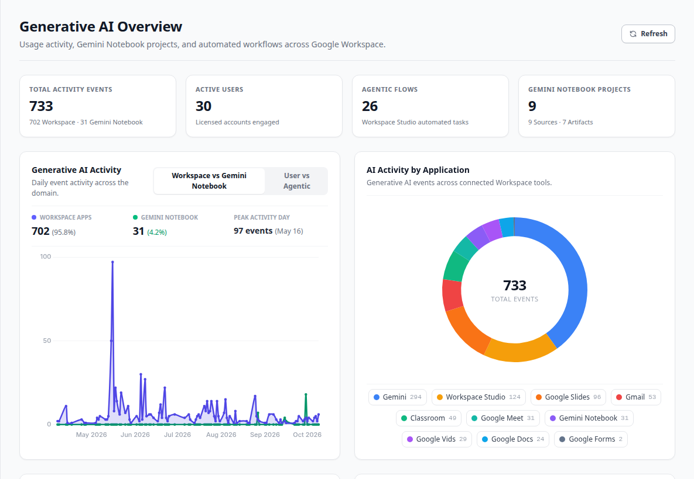
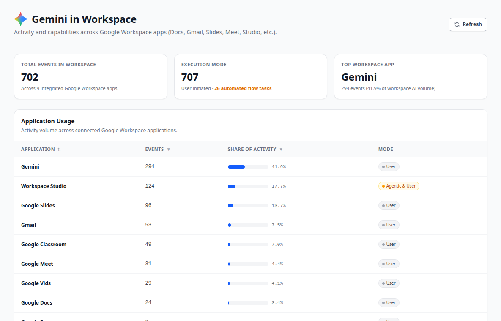
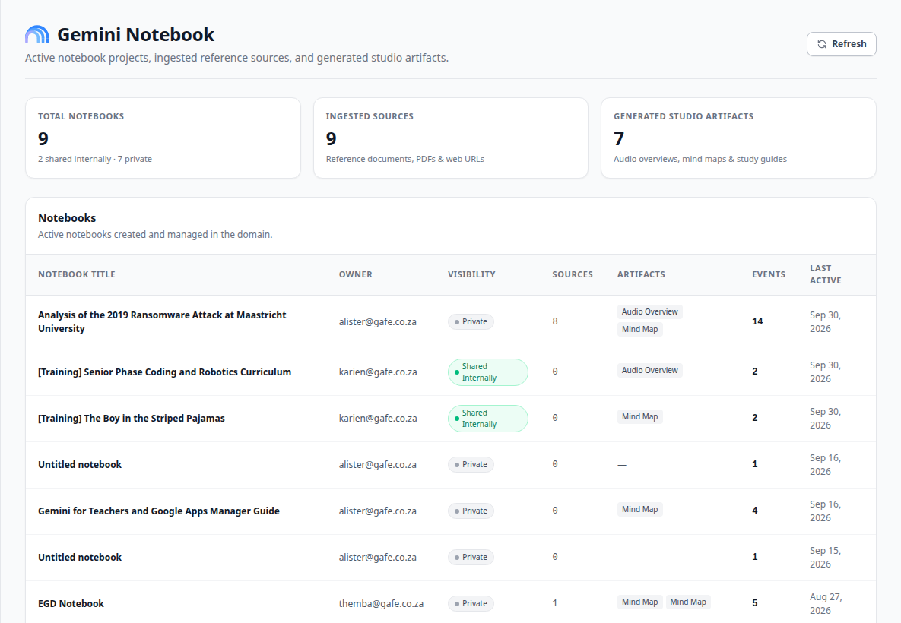
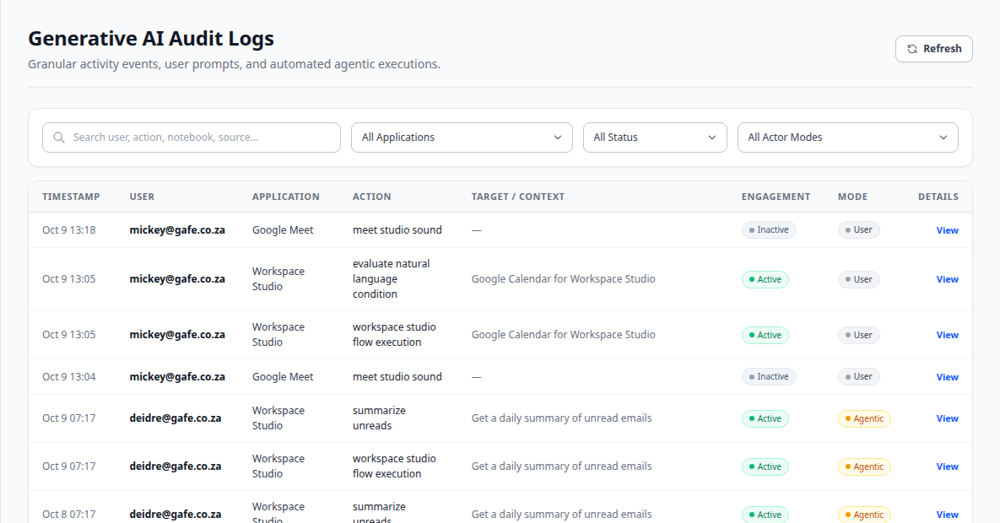

# AdminLens — Generative AI: A Quick Guide

**What this is:** AdminLens shows how people in the organisation use Google's AI tool, **Gemini**. You find it in the left menu under **Generative AI**. There are four pages. This guide explains what each page tells you.

> **Two words you will see a lot**
>
> **User initiated** — a person asked Gemini to do something (for example, "summarise this email").
>
> **Agentic** — Gemini did the work on its own, as part of an automated task that someone set up earlier.

## 1. Overview — the big picture

**Start here.** This page answers: *How much is AI being used, by whom, and for what?*

- **Four boxes at the top** — total AI activity, how many people used AI, how much work Gemini did on its own (*Agentic Flows*), and how many Gemini Notebooks exist.
- **Activity over time** — a line chart. Is AI use going up or down? You can switch between *Workspace vs Notebook* and *People vs Agents*.
- **Activity by app** — a ring chart showing which Google apps (Gmail, Docs, Meet and others) people use AI in the most.
- **AI capabilities & tasks** — what Gemini is being used *for*: writing, summarising, searching, and so on.
- **How AI is used** — split between chatting with Gemini, creating content, and AI working quietly in the background.
- **User activity table** — every person who used AI, with their totals. You can search and sort it.

## 2. Gemini in Workspace — AI inside Google apps

This page answers: *Which Google apps use AI, and which AI features are popular?*

- **Three boxes at the top** — total AI activity in Google apps, how much was started by people vs done automatically, and the most-used app.
- **Application Usage** — one line per app (Gmail, Docs, Sheets, Meet and others) with the amount of AI use and its share of the total.
- **Application Features** — one line per AI feature (for example "summarise unread emails") so you can see exactly which features people rely on.

## 3. Gemini Notebook — AI research notebooks

A **Gemini Notebook** is a workspace where a person uploads documents or web links, and Gemini helps them study and summarise that material. This page answers: *Who is doing AI research, and on what?*

- **Three boxes at the top** — how many notebooks exist (and how many are shared or private), how many documents and links were added, and how many items Gemini created (for example audio summaries, mind maps and study guides).
- **Notebooks table** — each notebook with its owner, whether it is shared, and how active it is.
- **Ingested Sources table** — every document or web link that was added to a notebook, by whom, and when.

## 4. Audit Logs — the detailed record

This page is the **full list of every single AI action**, newest first. Most people will not need it day to day. It is useful when you want to check *exactly* what a specific person did, or answer a question from a customer or auditor.

- **Search box** — find a person, app, or action.
- **Filters** — show one app only, active use vs background use, or people vs automated actions.
- **View** — click this on any line to see all the details of that one action.

## Good to know

- **The numbers are a snapshot.** They come from Google's records and change when the website is updated.
- **The pages show activity, not content.** You can see *that* someone used Gemini to summarise an email, but not what the email said.
- **"Agentic" numbers are reported by Google.** They show work done by automated AI tasks, not by a person at the keyboard.
