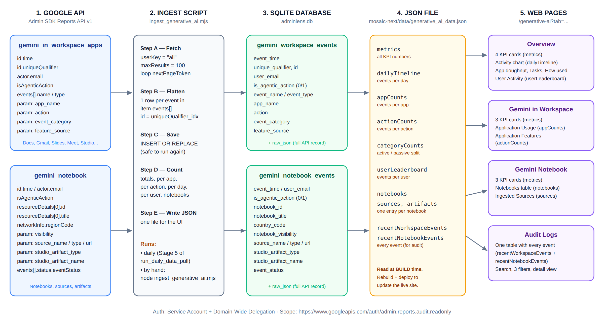
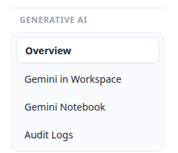
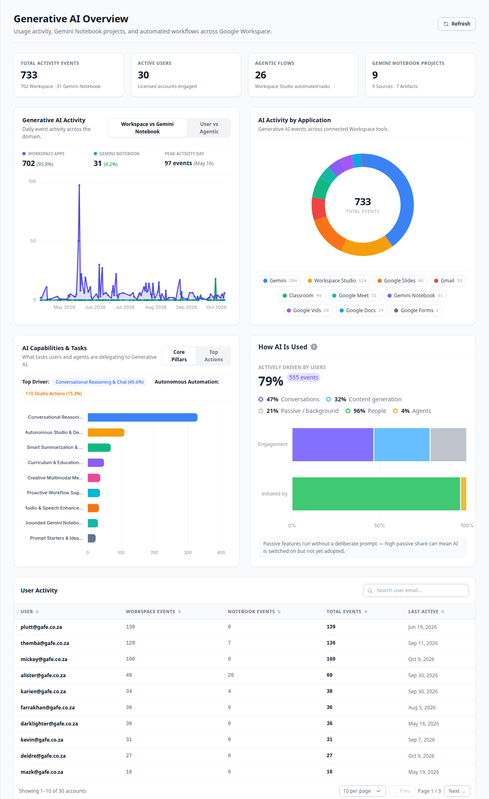
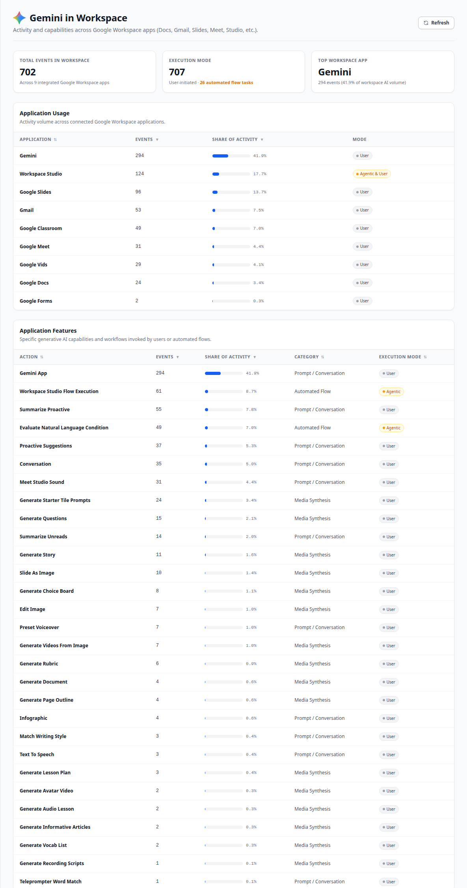
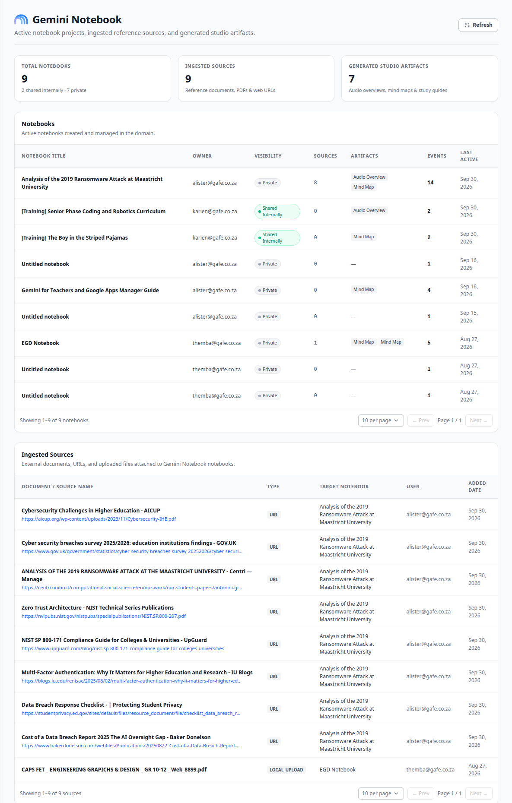
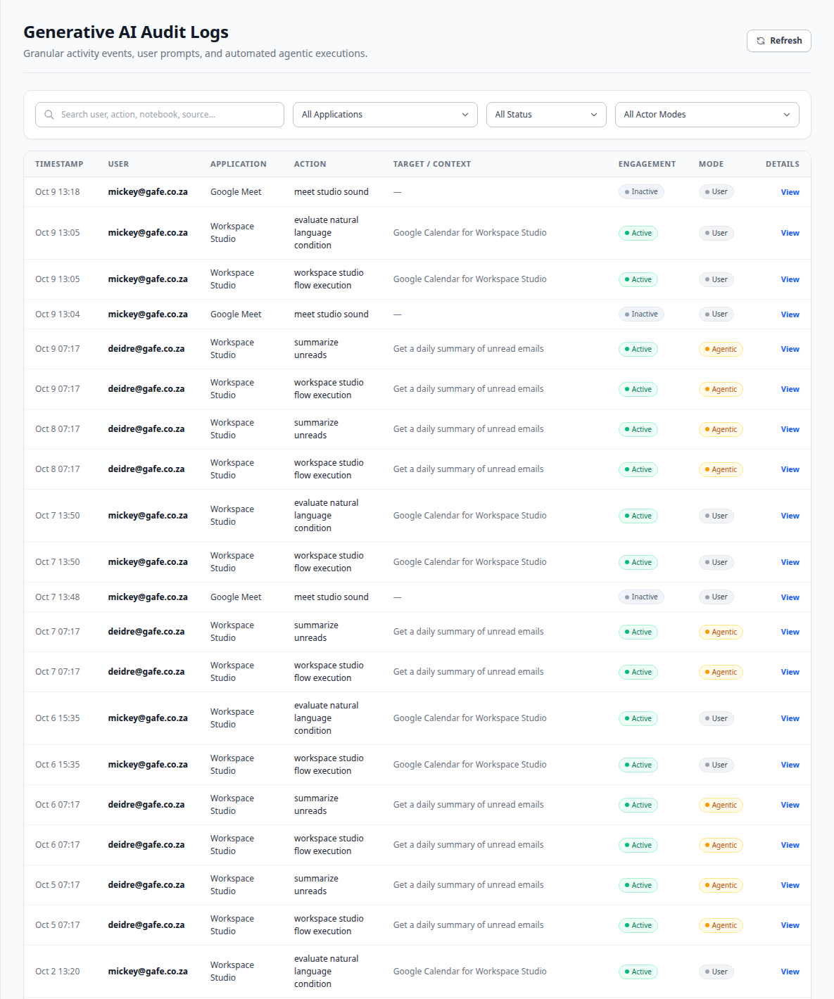

# AdminLens — Generative AI Module: Developer Guide

**Version:** 1.0 · **Date:** 10 October 2026 · **Live site:** https://app-list-dev-35635.web.app/generative-ai/

---

## 1. About this guide

This guide explains the **Generative AI** part of AdminLens.

You will learn:

1. Where the data comes from (Google API).
2. How the data moves from Google to the screen.
3. What each page shows, and which data each part uses.
4. How to update the data and publish the website.

> **How to read this guide:** Each section is short. Words in `code style` are exact names from the code. You can search for them in the project.

---

## 2. Words used in this guide

| Word | Meaning |
| :--- | :--- |
| **Event** | One action by one user. Example: a user asks Gemini a question. |
| **Workspace event** | An event from Gemini inside Google apps (Gmail, Docs, Slides, Meet, Workspace Studio, and others). |
| **Notebook event** | An event from Gemini Notebook (also called NotebookLM). Example: a user creates a notebook. |
| **Agentic** | Google marked the event as done by an automated agent, not by a person. We read this from the API field `isAgenticAction`. |
| **User-initiated** | The opposite of agentic. A person started the action. |
| **Active** | The user asked for something (a chat or generated content). |
| **Inactive / Passive** | Gemini worked in the background without a request. Example: Meet studio sound. |
| **Ingest** | Download data from Google and save it in our database. |
| **KPI card** | A small box at the top of a page that shows one important number. |

<div style="page-break-before: always"></div>

## 3. How the data moves (API mapping diagram)



The data moves in **5 steps**, from left to right:

1. **Google API.** Google stores audit logs. We read two log streams: `gemini_in_workspace_apps` and `gemini_notebook`.
2. **Ingest script.** The file `ingest_generative_ai.mjs` downloads all events from both streams.
3. **SQLite database.** The script saves each event as one row in `adminlens.db`. There are two tables, one for each stream.
4. **JSON file.** The script counts the events and writes one file: `mosaic-next/data/generative_ai_data.json`.
5. **Web pages.** The Next.js app reads the JSON file and shows the four pages.

> **Important:** The website reads the JSON file **when you build the website**, not when a user opens the page. After new data is ingested, you must **build and deploy again**. If you do not, the live website still shows the old data.

<div style="page-break-before: always"></div>

## 4. The Google API

### 4.1 Authentication

| Item | Value |
| :--- | :--- |
| API | Google Admin SDK **Reports API**, version `reports_v1` |
| Account type | Google Cloud **Service Account** with **Domain-Wide Delegation** |
| Key file | `gam-project-83tkn-bccbdf540703.json` (in the project root — keep it secret, do not commit it) |
| Acts as user | A Workspace super admin (in the code: `subject`) |
| OAuth scope | `https://www.googleapis.com/auth/admin.reports.audit.readonly` |

### 4.2 The API call

```http
GET https://admin.googleapis.com/admin/reports/v1/activity/users/all/applications/{applicationName}
```

| Parameter | Value | Why |
| :--- | :--- | :--- |
| `userKey` | `all` | Get events for every user in the domain. |
| `applicationName` | `gemini_in_workspace_apps` or `gemini_notebook` | We call the API **two times**, once for each stream. |
| `maxResults` | `100` | Google sends 100 records per page. |
| `pageToken` | value of `nextPageToken` | Repeat the call until `nextPageToken` is empty. Then you have all records. |

### 4.3 How one API record becomes database rows

One API record (an "activity") can contain **more than one event** in its `events[]` list. The script saves **one database row for each event**. The row ID is `uniqueQualifier` + `_` + the event's position in the list (for example `abc123_0`, `abc123_1`).

The script uses `INSERT OR REPLACE`. This means you can run the script many times. It does not create duplicate rows.

### 4.4 Field mapping — Workspace stream

API stream `gemini_in_workspace_apps` → table `gemini_workspace_events`

| Google API field | Database column | Example value |
| :--- | :--- | :--- |
| `id.time` | `event_time` | `2026-10-09T13:18:00Z` |
| `id.uniqueQualifier` | `unique_qualifier` (and part of `id`) | |
| `id.customerId` | `customer_id` | |
| `actor.email` | `user_email` | `mickey@gafe.co.za` |
| `actor.callerType` | `caller_type` | |
| `isAgenticAction` | `is_agentic_action` (0 or 1) | `1` |
| `events[].name` / `events[].type` | `event_name` / `event_type` | |
| parameter `app_name` | `app_name` | `gmail`, `workflows`, `gemini_app` |
| parameter `action` | `action` | `summarize_unreads` |
| parameter `event_category` | `event_category` | `active_generate`, `inactive` |
| parameter `feature_source` | `feature_source` | |
| (whole record) | `raw_json` | Full API record, for debugging |

### 4.5 Field mapping — Notebook stream

API stream `gemini_notebook` → table `gemini_notebook_events`

| Google API field | Database column | Example value |
| :--- | :--- | :--- |
| `id.time`, `actor.email` | `event_time`, `user_email` | |
| `isAgenticAction` | `is_agentic_action` (0 or 1) | `0` |
| `resourceDetails[0].id` | `notebook_id` | |
| `resourceDetails[0].title` | `notebook_title` | `EGD Notebook` |
| `networkInfo.regionCode` | `country_code` | Two-letter country code |
| `events[].status.eventStatus` | `event_status` | |
| parameter `visibility` | `notebook_visibility` | `private` |
| parameter `source_name` / `source_type` / `source_url` | `source_name` / `source_type` / `source_url` | `URL`, `LOCAL_UPLOAD` |
| parameter `studio_artifact_type` / `studio_artifact_name` | `studio_artifact_type` / `studio_artifact_name` | Shown on the page as "Audio Overview", "Mind Map" |
| (whole record) | `raw_json` | Full API record |

The full table definitions are in `schema.sql`.

<div style="page-break-before: always"></div>

## 5. The JSON file

The ingest script writes `mosaic-next/data/generative_ai_data.json`. This table shows each top-level key and where the website uses it.

| JSON key | What it contains | Used on page |
| :--- | :--- | :--- |
| `updatedAt` | Time the file was created | — |
| `metrics` | All totals (events, users, agentic count, notebooks, sources, artifacts) | KPI cards on all pages |
| `dailyTimeline` | Events per day, split by Workspace / Notebook and User / Agentic | Overview — activity chart |
| `appCounts` | Number of events for each app | Overview — doughnut chart; Gemini in Workspace — Application Usage |
| `actionCounts` | Number of events for each action | Overview — Capabilities chart; Gemini in Workspace — Application Features |
| `categoryCounts` | Events per category (`active_conversations`, `active_generate`, `inactive`) | Overview — How AI Is Used |
| `userLeaderboard` | One entry per user, with event counts and last active date | Overview — User Activity table |
| `notebooks` | One entry per notebook | Gemini Notebook — Notebooks table |
| `sources` | One entry per source added to a notebook | Gemini Notebook — Ingested Sources table |
| `artifacts` | One entry per generated artifact | Gemini Notebook — KPI count (the table uses `notebooks[].artifacts`) |
| `recentWorkspaceEvents` | Every Workspace event | Audit Logs |
| `recentNotebookEvents` | Every Notebook event | Audit Logs |

<div style="page-break-before: always"></div>

## 6. The pages

The module has **four pages**. They all use the same URL with a different `tab` value:

| Menu item | URL |
| :--- | :--- |
| Overview | `/generative-ai?tab=overview` |
| Gemini in Workspace | `/generative-ai?tab=apps` |
| Gemini Notebook | `/generative-ai?tab=notebooks` |
| Audit Logs | `/generative-ai?tab=audit` |



All four pages are in one component: `mosaic-next/app/(default)/generative-ai/generative-ai-client.tsx`. The charts are in `mosaic-next/components/generative-ai/`.

<div style="page-break-before: always"></div>

### 6.1 Overview page (`?tab=overview`)



<div style="page-break-before: always"></div>

| Part of the page | What it shows | Data source |
| :--- | :--- | :--- |
| **KPI: Total Activity Events** | All events (Workspace + Notebook) | `metrics.totalEvents` |
| **KPI: Active Users** | Users with at least one event | `metrics.totalActiveUsers` |
| **KPI: Agentic Flows** | Events where Google set `isAgenticAction = true` | `metrics.agenticEventsCount` |
| **KPI: Gemini Notebook Projects** | Number of notebooks, sources, artifacts | `metrics.notebooksCount` and others |
| **Chart: Generative AI Activity** | Line chart, events per day. Two buttons switch the view: *Workspace vs Gemini Notebook* or *User vs Agentic*. | `dailyTimeline` · `gen-ai-timeline-chart.tsx` |
| **Chart: AI Activity by Application** | Doughnut chart. Share of events for each app. Click a label to hide or show that app. | `appCounts` · `gen-ai-apps-doughnut.tsx` |
| **Chart: AI Capabilities & Tasks** | Bar chart. *Core Pillars* groups actions into 9 groups. *Top Actions* shows the 8 biggest actions. The two labels at the top are calculated from the data. | `actionCounts` · `gen-ai-capabilities-bar.tsx` |
| **Chart: How AI Is Used** | Two bars. Top bar: Conversations / Content generation / Passive. Bottom bar: People / Agents. | `categoryCounts` · `gen-ai-engagement-mix.tsx` |
| **Table: User Activity** | One row per user. Search by email. Click a column title to sort. 10, 25, 50 or 100 rows per page. | `userLeaderboard` |

The four charts are in a 2 × 2 grid. Cards in the same row always have the same height. The charts cannot be closed or hidden.

<div style="page-break-before: always"></div>

### 6.2 Gemini in Workspace page (`?tab=apps`)



<div style="page-break-before: always"></div>

| Part of the page | What it shows | Data source |
| :--- | :--- | :--- |
| **KPI: Total Events in Workspace** | Events from Google apps only (no Notebook events) | `metrics.totalWorkspaceEvents` |
| **KPI: Execution Mode** | User-initiated events and agentic events | `metrics.userInitiatedCount`, `metrics.agenticEventsCount` |
| **KPI: Top Workspace App** | The app with the most events | `appCounts` (highest value) |
| **Table: Application Usage** | One row per app: events, share bar, mode. Click a column title to sort. | `appCounts` |
| **Table: Application Features** | One row per action: events, share bar, category, execution mode. Click a column title to sort. | `actionCounts` |

<div style="page-break-before: always"></div>

### 6.3 Gemini Notebook page (`?tab=notebooks`)



<div style="page-break-before: always"></div>

| Part of the page | What it shows | Data source |
| :--- | :--- | :--- |
| **KPI: Total Notebooks** | Number of notebooks, and how many are shared or private | `metrics.notebooksCount`, `notebooks[].visibility` |
| **KPI: Ingested Sources** | Documents, PDFs and web links added to notebooks | `metrics.sourcesIngestedCount` |
| **KPI: Generated Studio Artifacts** | Audio overviews, mind maps, study guides | `metrics.artifactsCount` |
| **Table: Notebooks** | Title, owner, visibility, number of sources, artifacts, events, last active date | `notebooks` |
| **Table: Ingested Sources** | Source name and link, type (`URL`, `LOCAL_UPLOAD`), notebook, user, date added | `sources` |

<div style="page-break-before: always"></div>

### 6.4 Audit Logs page (`?tab=audit`)



<div style="page-break-before: always"></div>

| Part of the page | What it shows | Data source |
| :--- | :--- | :--- |
| **Search box** | Searches user, action, app, notebook title and source name | — |
| **Filter: Applications** | Show events from one app only | `appName` |
| **Filter: Status** | *Active Usage* or *Inactive / Ambient* | `category` (`inactive` = inactive) |
| **Filter: Actor Modes** | *User Initiated* or *Agentic Automated* | `isAgenticAction` |
| **Table** | Time, user, app, action, target, engagement, mode. Newest events first. | `recentWorkspaceEvents` + `recentNotebookEvents` |
| **View (Event Details)** | A pop-up window with the event fields and the full event as JSON | The selected event from the JSON file |

<div style="page-break-before: always"></div>

## 7. How to update data and publish

### 7.1 Automatic update (every day)

The daemon `run_sync_daemon.mjs` starts `run_daily_data_pull.mjs` every 24 hours. **Stage 5** of that script runs `ingest_generative_ai.mjs`.

### 7.2 Manual update

Run these commands in order:

```bash
# 1. Download new events and write the JSON file
cd /home/alister/MCP-servers/adminlens-investigation
node ingest_generative_ai.mjs

# 2. Build the website (this reads the new JSON file)
cd mosaic-next
npm run build

# 3. Publish to Firebase Hosting
npx firebase-tools deploy --only hosting
```

Firebase project: `app-list-dev-35635`. The build output folder is `mosaic-next/out` (see `firebase.json`).

### 7.3 Check your work before you publish

```bash
cd mosaic-next
npx tsc --noEmit          # TypeScript check — must show no errors
npx eslint "app/(default)/generative-ai" components/generative-ai
```

<div style="page-break-before: always"></div>

## 8. Known issues and things to be careful with

Please read this list before you change the code. These are not bugs in Google's data. They are decisions or gaps in our code.

1. **The Refresh button works only on a local computer.** It calls `http://localhost:3333/api/generative-ai/sync` (in `server.mjs`). On the live Firebase site, there is no server, so the button cannot work. To update the live site, use section 7.2.

2. **"Agentic" has two different meanings.**
   * The KPI **Agentic Flows (26)** counts events where **Google** set `isAgenticAction = true`.
   * The label **Autonomous Automation (110 Studio Actions)** on the Capabilities chart counts events with a Workspace Studio **action name** (`classic_use_case_workspace_studio_flow_execution` and `evaluate_natural_language_condition`).
   * Google marks some Studio flows as started by a user. So these two numbers are different. This is correct, but users may ask about it.

3. **"Execution Mode" on the Gemini in Workspace page includes Notebook events.** The number (707) is bigger than "Total Events in Workspace" (702). This is because `metrics.userInitiatedCount` counts Workspace **and** Notebook events. To fix it, add a Workspace-only count in the ingest script.

4. **"Owner" of a notebook is a guess.** The API does not send the notebook owner. We use the email of the **first event** we see for that notebook.

5. **Google Forms is missing from the Applications filter** on the Audit Logs page. It has events (2), but there is no option for it in the drop-down list.

6. **The "Agentic & User" mode** in the Application Usage table is fixed for Workspace Studio. It is not calculated from the data.

7. **App names are mapped by hand.** If Google adds a new `app_name`, add a name and colour in `APP_META` in `gen-ai-apps-doughnut.tsx`, and add a filter option on the Audit Logs page.

---

## 9. Important files

| File | Purpose |
| :--- | :--- |
| `ingest_generative_ai.mjs` | Downloads events, saves to SQLite, writes the JSON file |
| `schema.sql` | Database table definitions |
| `run_daily_data_pull.mjs` / `run_sync_daemon.mjs` | Daily automatic update |
| `server.mjs` | Local API used by the Refresh button |
| `mosaic-next/data/generative_ai_data.json` | Data file read by the website |
| `mosaic-next/app/(default)/generative-ai/page.tsx` | Reads the JSON file at build time |
| `mosaic-next/app/(default)/generative-ai/generative-ai-client.tsx` | All four pages, tables, filters |
| `mosaic-next/components/generative-ai/*.tsx` | The four Overview charts and the chart card |
| `mosaic-next/components/ui/sidebar.tsx` | Sidebar menu |
| `docs/dev-guide/img/api-mapping-diagram.svg` | The diagram in this guide (you can edit it) |
